<div align="center">


# Supercat: Boss Rush

**Um boss rush 2D em pixel art feito em Python + Pygame.**
Controle o Supercat, desvie de chuvas de tiros e derrote cinco chefes seguidos usando bolas de pelo.


-F5A13A)


</div>

---

## Sobre o jogo

*Supercat: Boss Rush* é um jogo de ação com visão de cima em que o jogador enfrenta **apenas chefes**, um atrás do outro. Cada chefe tem um padrão de ataque próprio e, ao ser derrotado, deixa um **power-up** que deixa o Supercat mais forte para a próxima luta.

O projeto começou na **Sprint 03** como protótipo e hoje é uma versão beta completa, do menu à tela de vitória. Os **5 chefes são gatos supervilões** em pixel art feitos no Aseprite, cada um com sua arena, seu tiro e uma **fase de fúria** quando a vida chega na metade. Os arquivos editáveis da arte ficam em `assets/aseprite/`.

<p align="center">
  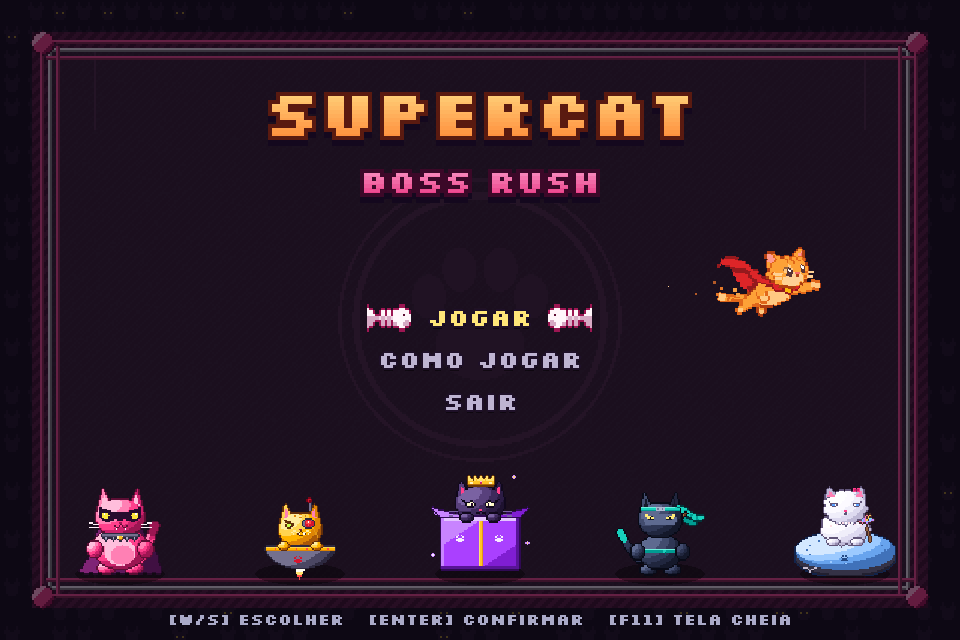
  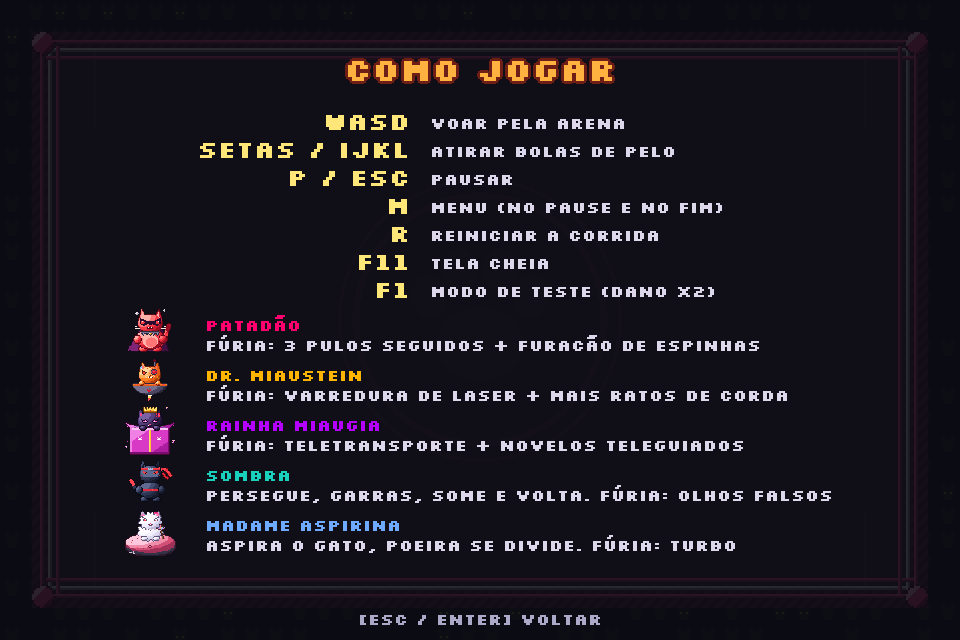
</p>

## Como jogar

### Requisitos

- Python 3.10 ou mais recente
- [pygame-ce](https://pyga.me/) (ou `pygame`)

### Instalação

```bash
git clone https://github.com/<usuario>/<repositorio>.git
cd <repositorio>
pip install pygame-ce
python bossrush.py
```

> A pasta `assets/` precisa ficar ao lado do `bossrush.py`. Se ela faltar, o jogo não quebra: volta a desenhar o jogador como um círculo.

### Controles

| Tecla | Ação |
|---|---|
| `W` `A` `S` `D` | Mover |
| Setas ou `I` `J` `K` `L` | Atirar (4 direções) |
| `P` ou `Esc` | Pausar |
| `F11` | Tela cheia (sem distorcer a imagem) |
| `R` | Reiniciar |
| `M` | Voltar ao menu (no pause e no fim de jogo) |
| `F1` | Liga/desliga o **modo de teste** (dano x10) |

### Modo de teste

Pra testar os chefes rápido, aperte **F1** (no menu ou durante a luta): as bolas de pelo passam a causar **10x mais dano** e aparece o selo "MODO TESTE" no canto da tela. Aperte F1 de novo pra desligar.
No começo do `bossrush.py` dá pra ajustar o multiplicador (`DANO_MODO_TESTE`) ou deixar o modo ligado já ao abrir o jogo (`MODO_TESTE = True`).

## Os chefes

O jogo começa num **menu** (Jogar / Como jogar / Sair). Cada chefe entra caindo do céu e, quando a vida chega na **metade**, entra em **FÚRIA**: muda de visual, a arena fica avermelhada e ele ganha ataques novos.


| Onda | Chefe | Vida | Como ataca |
|:---:|---|:---:|---|
| 1 | **PATADÃO** | 280 | Leque de 8 espinhas de peixe e um **salto** que termina num anel de tiros. **Fúria:** combo de 3 pulos e furacão de espinhas em espiral |
| 2 | **DR. MIAUSTEIN** | 360 | Rajadas de 6 lasers e até **4 ratos de corda** que orbitam e investem. **Fúria:** varredura de laser em 3 braços (com aviso), rajadas de 10 e até 6 ratos mais rápidos |
| 3 | **RAINHA MIAUGIA** | 480 | Anel de 12 novelos e um trio mirado. **Fúria:** teletransporte pela arena, anéis de 16 alternados e novelos teleguiados |
| 4 | **SOMBRA**, o Gato Ninja | 520 | **Persegue** devagar lançando **leques de 3 garras**; depois **some**, mostra os **olhos brilhando** onde vai surgir e reaparece soltando um **anel de 8 garras** (só leva dano quando está visível). **Fúria:** mais rápido, leques de 5, anel de 12, **olhos falsos** de isca e às vezes some duas vezes seguidas |
| 5 | **MADAME ASPIRINA**, a Duquesa da Faxina | 600 | Gata persa num **robô aspirador** que anda reto e quica nas paredes. **Aspira o Supercat** (voe contra!) e cospe **bolas de poeira que se dividem**. **Fúria:** modo turbo, aspira mais vezes, espiral de poeira enquanto suga e poeira a cada batida |

<p align="center">
  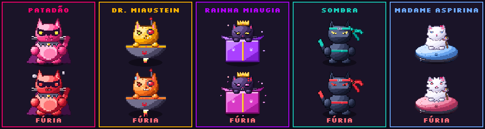
</p>

| Fase 1 | Fúria |
|:---:|:---:|
| 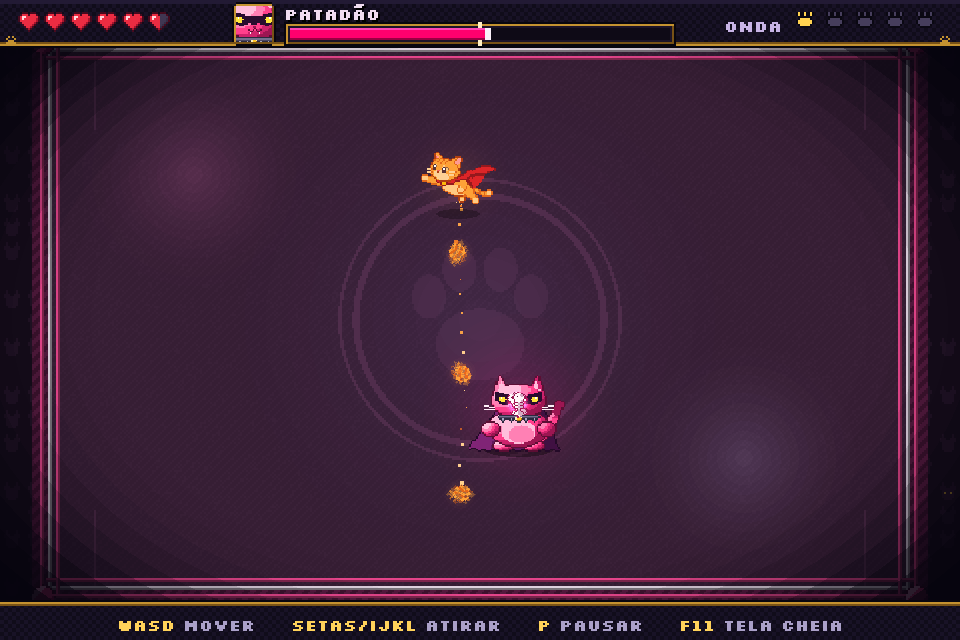 | 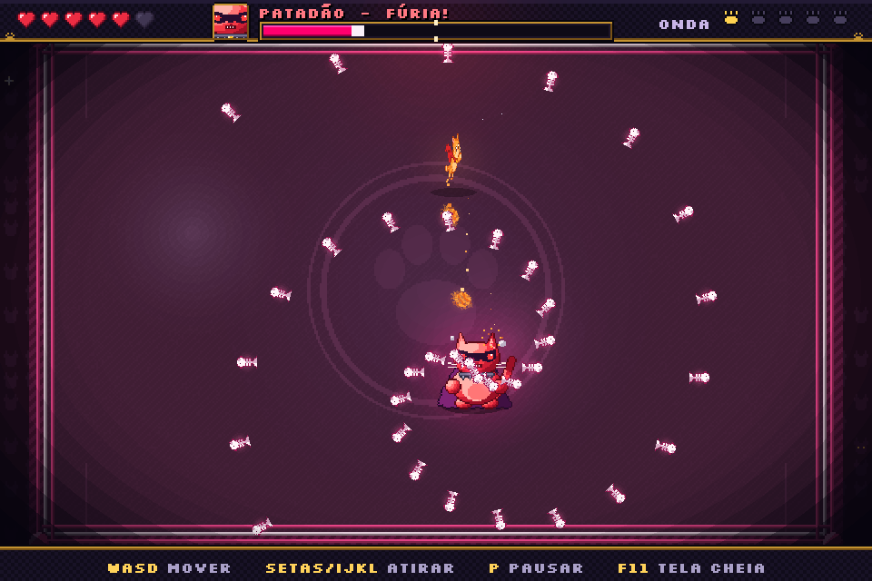 |
| **Onda 1: PATADÃO**, no ringue | Furacão de espinhas de peixe |
| 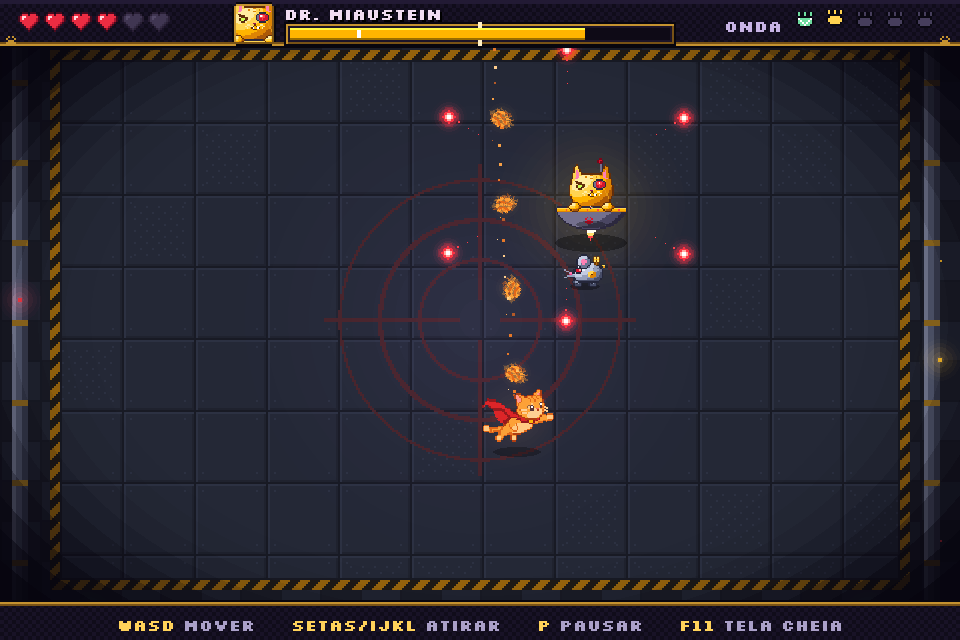 | 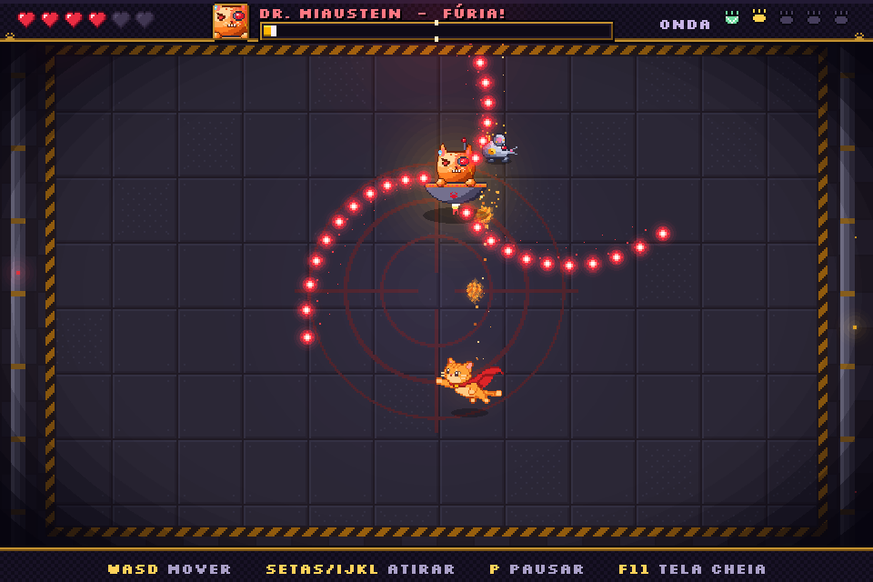 |
| **Onda 2: DR. MIAUSTEIN** e os ratos de corda | Varredura de laser em 3 braços |
| 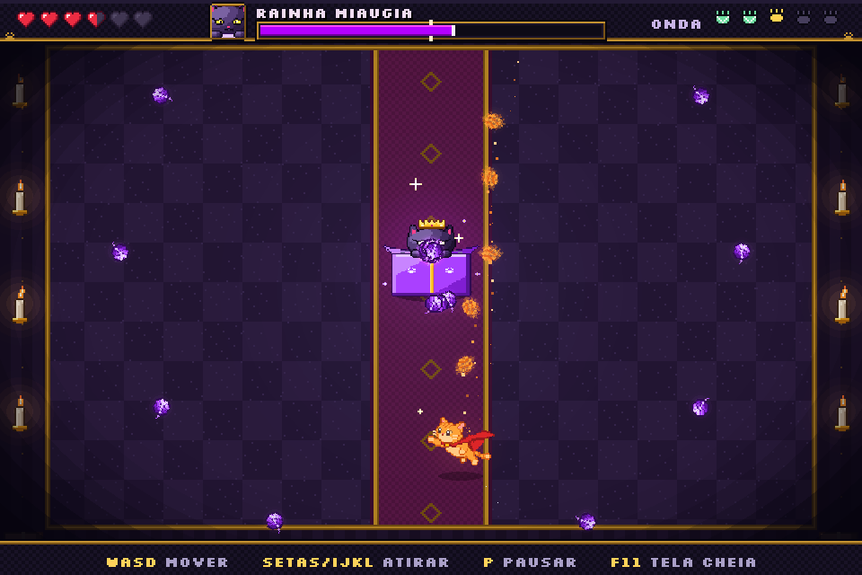 | 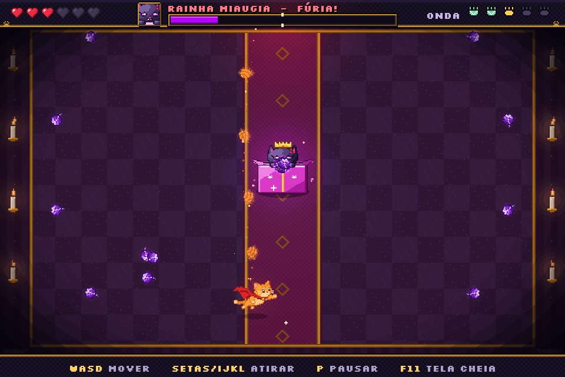 |
| **Onda 3: RAINHA MIAUGIA**, no salão do trono | Anéis alternados e novelos teleguiados |
| 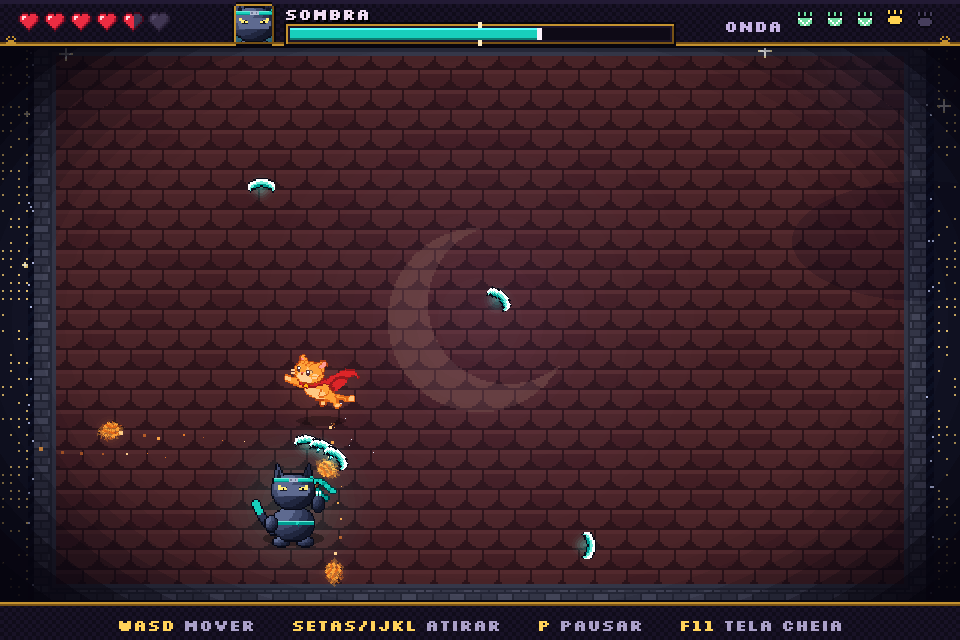 | 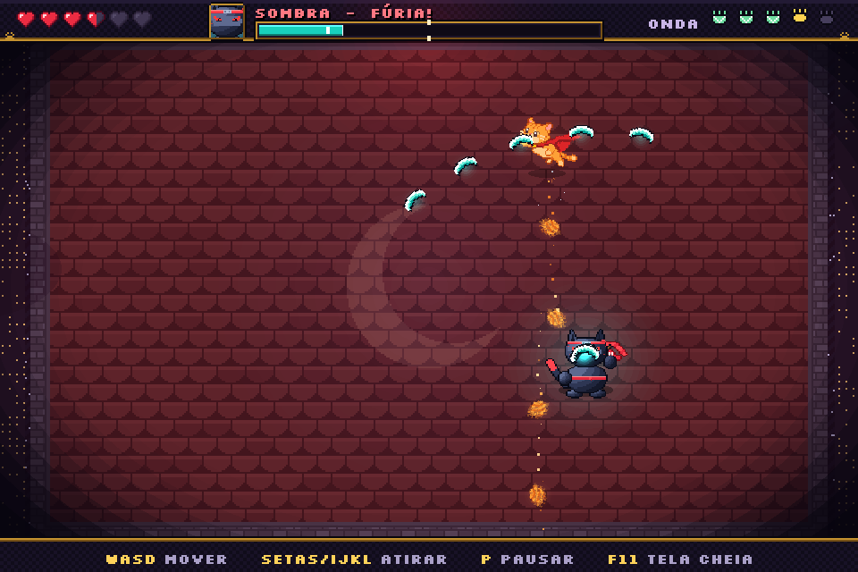 |
| **Onda 4: SOMBRA**, no telhado | Leques de 5 garras e olhos falsos |
| 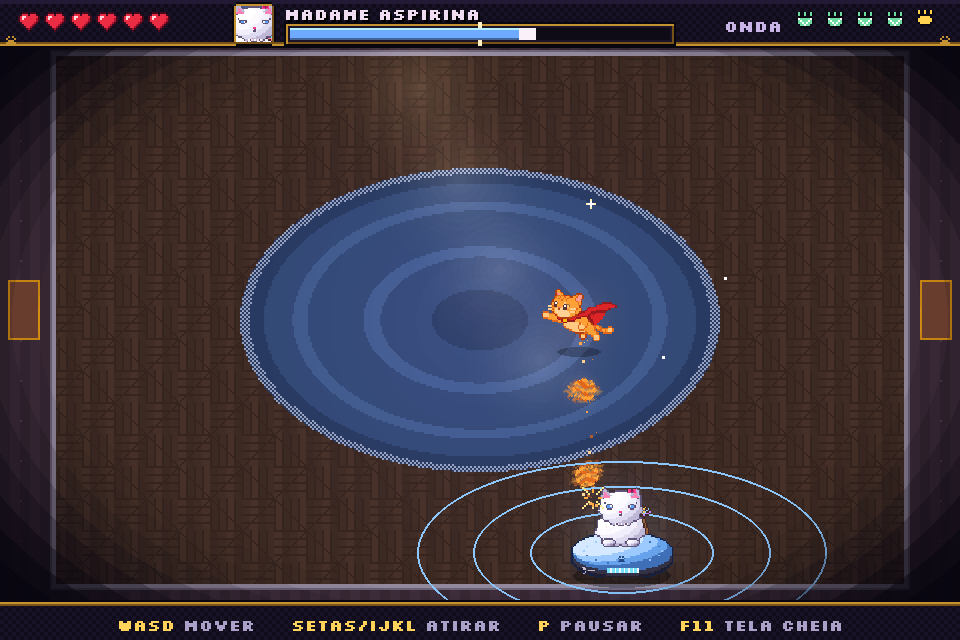 | 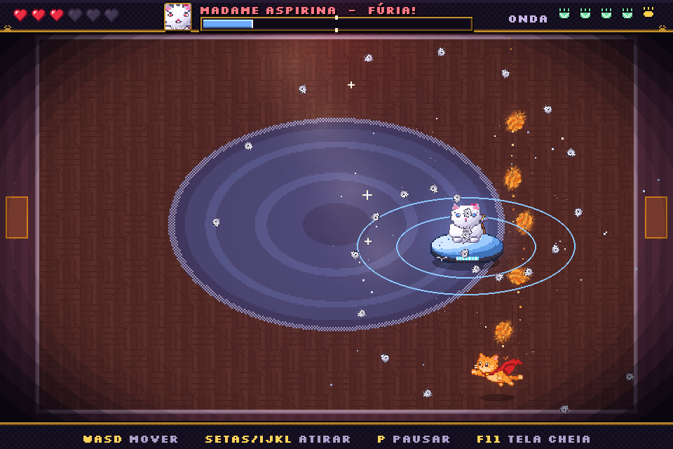 |
| **Onda 5: MADAME ASPIRINA**, aspirando o Supercat | Modo turbo com espiral de poeira |

Tiros e lacaios: ratos de corda (orbitando e atacando), espinha de peixe, laser, novelo, garra e bola de poeira.

<p align="center">
  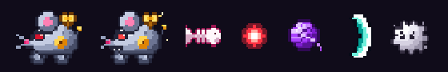
</p>

## Direção de arte

- **Pixel sempre nítido:** a tela é ampliada sem suavização (nada de borrão em tela cheia) e todo texto usa a fonte pixel **Silkscreen** (licença OFL, em `assets/fontes/`).
- **HUD em pixel art:** corações com meia-vida, retrato do chefe (muda na fúria), moldura da barra de vida com marca da metade e indicador de ondas com patinhas.
- **Luz:** brilho aditivo nos tiros, luz colorida embaixo de cada chefe, vinheta nas bordas.
- **Cenários vivos:** holofotes e flashes de câmera no ringue, luzes piscando e tubos borbulhando no laboratório, velas tremulando no salão do trono, lua e estrelas no telhado, raios de sol na sala de estar.
- **Efeitos animados feitos no Aseprite:** poeira, explosão, faísca de impacto, brilhos e a almofada de veludo dos power-ups.

## Power-ups

Depois de cada chefe aparece um power-up no centro da arena. Pegar o item libera a próxima onda.

| | Item | Efeito |
|:---:|---|---|
|  | **Ração** | **+Fire rate**: atira mais rápido |
|  | **Erva-de-gato** | **+Damage**: +3 de dano por tiro |
|  | **3 bolas de pelo** | **+Range & size**: tiros vão mais longe e ficam maiores |
|  | **Coração** | **+Vida**: recupera 3 corações (aparece depois da onda 3) |

## O Supercat

O herói muda de expressão conforme o que acontece na partida:

| Normal | Triste | Feliz |
|:---:|:---:|:---:|
|  |  |  |
| Estado padrão da luta | Ao tomar dano e no game over | Ao derrotar um chefe, pegar power-up e na vitória |

Animações e efeitos:

- Flutua, inclina ao subir ou descer e tem sombra embaixo
- Vira com animação para o lado em que anda ou atira (o tiro tem prioridade, então andar para um lado e atirar para o outro não faz o gato "piscar")
- Tranco e puff de pelo a cada tiro; as bolas de pelo giram e deixam rastro
- Ao tomar dano: pisca em vermelho, solta faíscas e a tela treme
- Coraçõezinhos quando está feliz
- Capa esvoaçando e patinhas batendo (4 quadros de voo por expressão)
- Chefes piscam ao levar tiro, ficam com olhos em X na derrota e explodem

<p align="center">
  
  
</p>

## Estrutura do projeto

```
.
├── bossrush.py              # jogo completo (menu, loop, jogador, chefes, power-ups, efeitos, HUD)
├── assets/
│   ├── gato_*.png           # Supercat parado (normal, feliz, triste)
│   ├── supercat_voando.png  # 12 quadros de voo (4 por expressão)
│   ├── boss_*.png           # os 5 chefes (parado, ataque, fúria, derrota)
│   ├── drone.png            # ratos de corda do DR. MIAUSTEIN
│   ├── tiro_*.png           # tiros de cada chefe
│   ├── cenario_*.png        # as 5 arenas
│   ├── hud_*.png, fx_*.png, prop_*.png   # HUD, efeitos animados e objetos de cenário
│   ├── racao.png, erva_de_gato.png, bolas_de_pelo_triplas.png, coracao.png
│   ├── aseprite/            # arquivos .aseprite editáveis de toda a arte nova
│   └── fontes/              # fonte pixel Silkscreen (licença OFL)
├── ferramentas_aseprite/    # scripts Lua que geram a arte dentro do Aseprite
└── docs/                    # imagens usadas neste README
```

### Detalhes técnicos

- **Tela virtual de 960×640**, ampliada para a janela mantendo a proporção (sem esticar no `F11`).
- **Movimento com delta time**, aceleração e atrito, para o jogo rodar igual em qualquer FPS.
- **Colisões entre círculos**: o sprite do Supercat é só o desenho; a hitbox continua um círculo de raio 16.
- **Dano centralizado** em `PlayerShip.take_damage()`, que também troca a expressão do gato.
- **Sprites ampliados sem filtro** (`pygame.transform.scale`), mantendo o pixel art nítido.
- Os ajustes de animação ficam em constantes no topo do arquivo (`CAT_SCALE`, `TURN_TIME`, `BOB_AMP`, `TILT_MAX`, `MAX_PARTICLES`…).
- **Chefes com uma base comum** (`BossBase`): entrada caindo do céu, transformação de fúria na metade da vida, animação de derrota, achatar ao levar tiro e barra de vida com rastro.
- **Fallback sem arte:** se algum PNG faltar, aquele elemento volta a ser desenhado com formas simples em vez de quebrar o jogo.

## Próximos passos

- [x] Usar o coração como vida no HUD, no lugar dos blocos
- [x] Arte dos chefes, dos drones e das arenas
- [x] Nomes finais dos chefes e cor própria na barra de vida de cada um
- [x] Menu inicial
- [x] Fase de fúria para cada chefe
- [ ] Sons e música
- [ ] Balancear o dano do jogador e a vida de cada chefe com playtests
- [ ] Placar com o tempo da corrida

## Equipe

| Integrante | Frente |
|---|---|
| **Henrique Vieira** | Programação: sprites e animações |
| **Nicoly Siqueira** | Arte: Supercat, bolas de pelo e power-ups |
| **Rafael Weykamp** | Game design: organização e jogo base |

---

<div align="center">
<sub>Projeto acadêmico desenvolvido na Sprint 03.</sub>
</div>
