<div align="center">

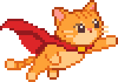

# Supercat: Boss Rush

**Um boss rush 2D em pixel art feito em Python + Pygame.**
Controle o Supercat, desvie de chuvas de tiros e derrote três chefes seguidos usando bolas de pelo.


-F5A13A)

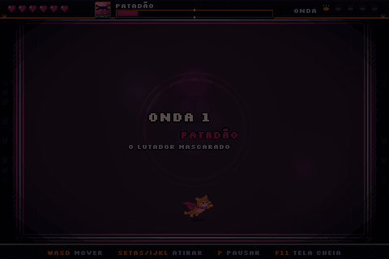

</div>

---

## Sobre o jogo

*Supercat: Boss Rush* é um jogo de ação com visão de cima em que o jogador enfrenta **apenas chefes**, um atrás do outro. Cada chefe tem um padrão de ataque próprio e, ao ser derrotado, deixa um **power-up** que deixa o Supercat mais forte para a próxima luta.

O projeto foi desenvolvido durante a **Sprint 03** como protótipo jogável. Saímos do zero e chegamos a uma versão beta com o jogo completo do início ao fim, o personagem animado e power-ups com arte própria. Os chefes ainda são formas geométricas, que já funcionam como as hitboxes do jogo final.

## Como jogar

### Requisitos

- Python 3.10 ou mais recente
- [pygame-ce](https://pyga.me/) (ou `pygame`)

### Instalação

```bash
git clone https://github.com/<usuario>/<repositorio>.git
cd <repositorio>
pip install pygame-ce
python bossrush.py
```

> A pasta `assets/` precisa ficar ao lado do `bossrush.py`. Se ela faltar, o jogo não quebra: volta a desenhar o jogador como um círculo.

### Controles

| Tecla | Ação |
|---|---|
| `W` `A` `S` `D` | Mover |
| Setas ou `I` `J` `K` `L` | Atirar (4 direções) |
| `P` ou `Esc` | Pausar |
| `F11` | Tela cheia (sem distorcer a imagem) |
| `R` | Reiniciar |

## Os chefes

| Onda | Chefe | Vida | Como ataca |
|:---:|---|:---:|---|
| 1 | **Prisma** | 280 | Leque de 8 tiros mirados e um **salto** sobre o jogador que termina num anel de tiros |
| 2 | **Orbital** | 360 | Rajadas de 6 tiros e até **4 drones** que orbitam e depois investem contra o jogador |
| 3 | **Núcleo** | 480 | Anel de 12 tiros a cada 1,5 s e um trio de tiros mirados |

<p align="center">
  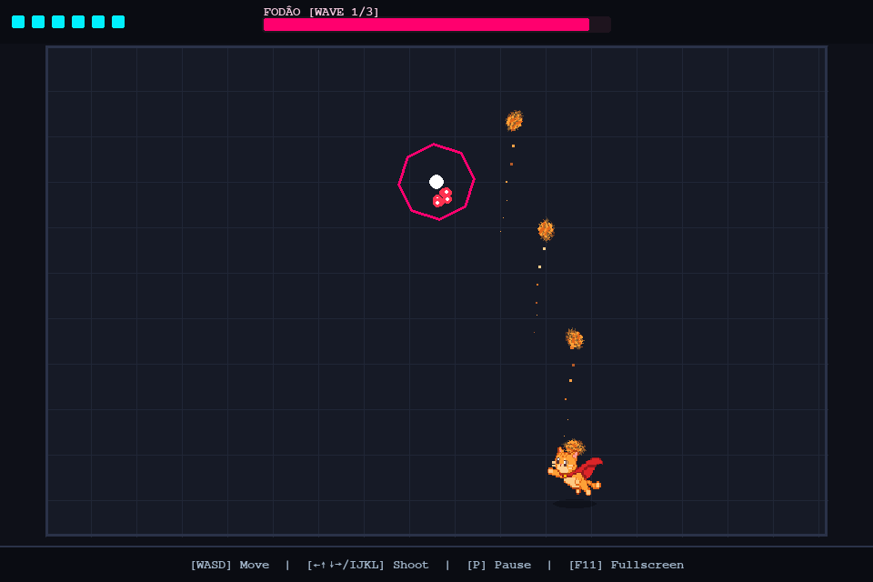
  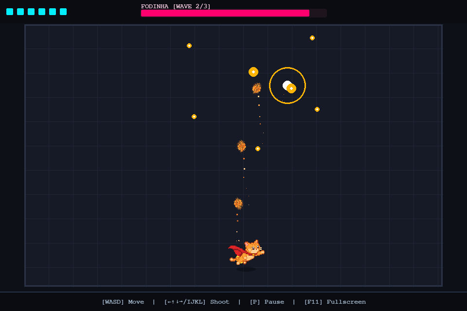
  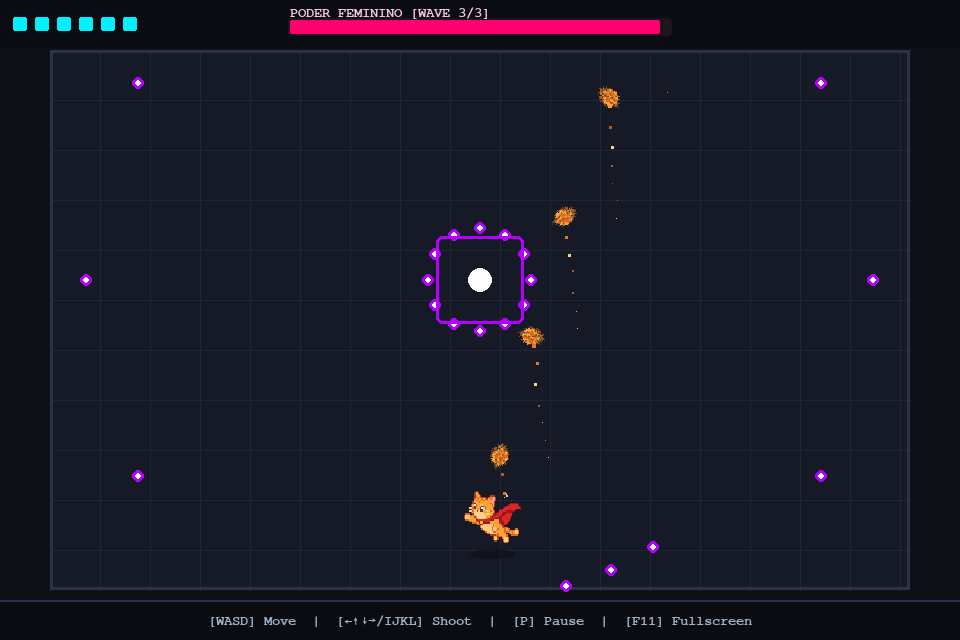
</p>

## Power-ups

Depois de cada chefe aparece um power-up no centro da arena. Pegar o item libera a próxima onda.

| | Item | Efeito |
|:---:|---|---|
| 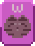 | **Ração** | **+Fire rate**: atira mais rápido |
| 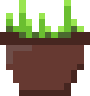 | **Erva-de-gato** | **+Damage**: +3 de dano por tiro |
| 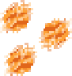 | **3 bolas de pelo** | **+Range & size**: tiros vão mais longe e ficam maiores |

## O Supercat

O herói muda de expressão conforme o que acontece na partida:

| Normal | Triste | Feliz |
|:---:|:---:|:---:|
| 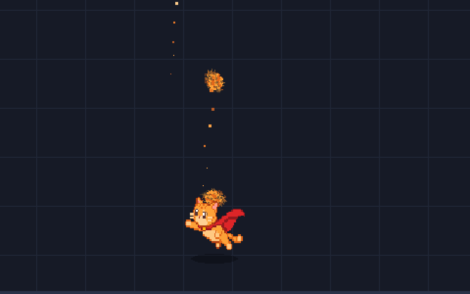 | 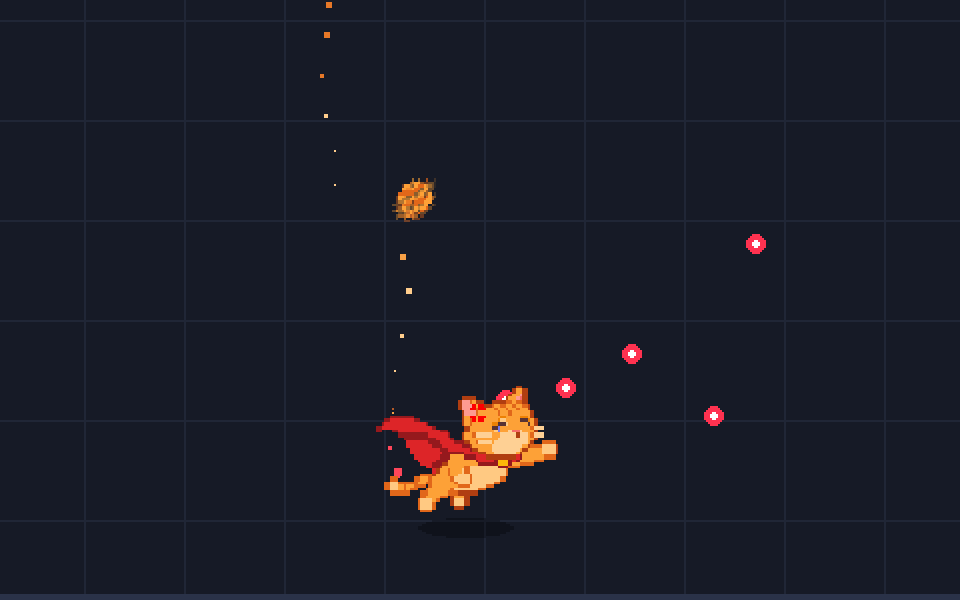 | 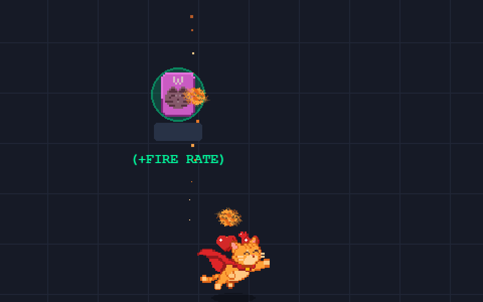 |
| Estado padrão da luta | Ao tomar dano e no game over | Ao derrotar um chefe, pegar power-up e na vitória |

Animações e efeitos:

- Flutua, inclina ao subir ou descer e tem sombra embaixo
- Vira com animação para o lado em que anda ou atira (o tiro tem prioridade, então andar para um lado e atirar para o outro não faz o gato "piscar")
- Tranco e puff de pelo a cada tiro; as bolas de pelo giram e deixam rastro
- Ao tomar dano: pisca em vermelho, solta faíscas e a tela treme
- Coraçõezinhos quando está feliz
- Chefes piscam ao levar tiro e explodem em partículas ao morrer

<p align="center">
  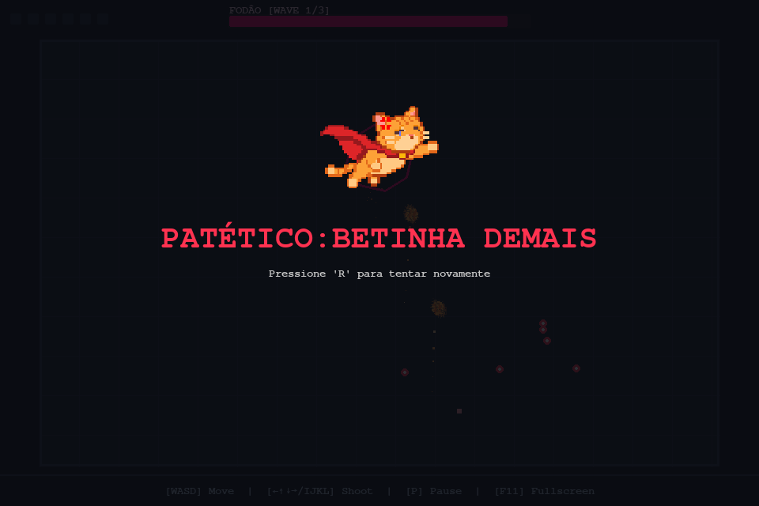
  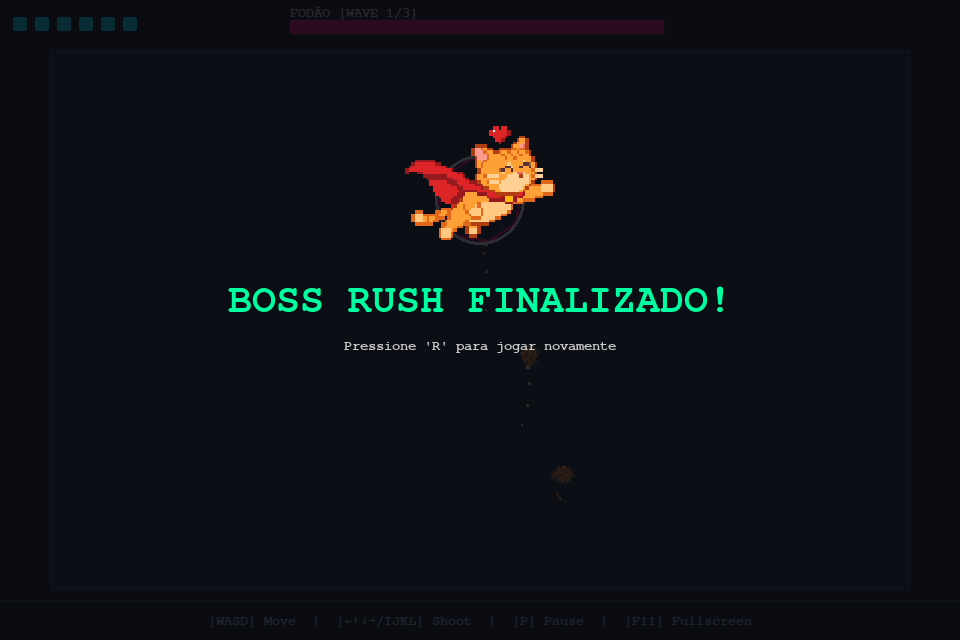
</p>

## Estrutura do projeto

```
.
├── bossrush.py          # jogo completo (loop, jogador, chefes, power-ups, efeitos)
├── assets/              # sprites em pixel art (50×50)
│   ├── gato_normal.png
│   ├── gato_feliz.png
│   ├── gato_triste.png
│   ├── bola_de_pelo.png
│   ├── bolas_de_pelo_triplas.png
│   ├── erva_de_gato.png
│   ├── racao.png
│   └── coracao.png
└── docs/                # imagens usadas neste README
```

### Detalhes técnicos

- **Tela virtual de 960×640**, ampliada para a janela mantendo a proporção (sem esticar no `F11`).
- **Movimento com delta time**, aceleração e atrito, para o jogo rodar igual em qualquer FPS.
- **Colisões entre círculos**: o sprite do Supercat é só o desenho; a hitbox continua um círculo de raio 16.
- **Dano centralizado** em `PlayerShip.take_damage()`, que também troca a expressão do gato.
- **Sprites ampliados sem filtro** (`pygame.transform.scale`), mantendo o pixel art nítido.
- Os ajustes de animação ficam em constantes no topo do arquivo (`CAT_SCALE`, `TURN_TIME`, `BOB_AMP`, `TILT_MAX`, `MAX_PARTICLES`…).

## Próximos passos

- [ ] Usar o coração como vida no HUD, no lugar dos blocos
- [ ] Arte dos 3 chefes, dos drones e da arena
- [ ] Balancear o dano do jogador e definir o número de drones
- [ ] Nomes finais dos chefes e cor própria na barra de vida de cada um
- [ ] Sons e menu inicial

## Equipe

| Integrante | Frente |
|---|---|
| **Henrique Vieira** | Programação: sprites e animações |
| **Nicoly Siqueira** | Arte: Supercat, bolas de pelo e power-ups |
| **Rafael Weykamp** | Game design: organização e jogo base |

---

<div align="center">
<sub>Projeto acadêmico desenvolvido na Sprint 03.</sub>
</div>
